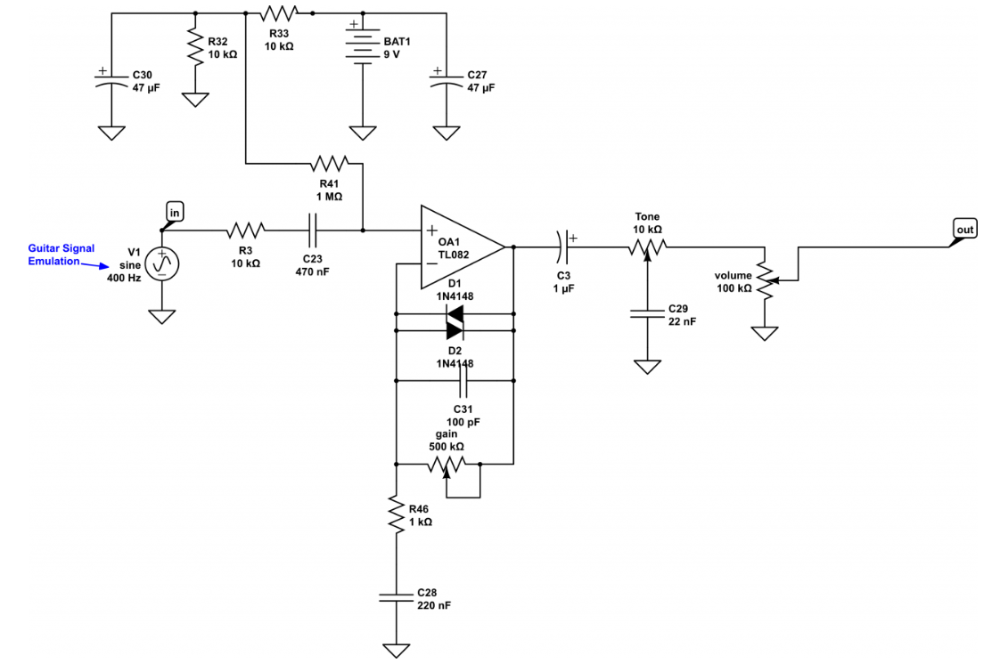

# Reference

At the beginning of this process, I looked at this schematic and knew absolutely nothing about it. It was intimidating as I had very brief knowledge of AC analysis from my circuits 1 course. The majority of this project was done trying to understand the reason behind every component and its value on this existing circuit. Because this is my first independent project, there are many features on my pedal that are very similar to this pedal. My main goal throughout this process was to understand this existing pedal, while adding my own embellishments. 

